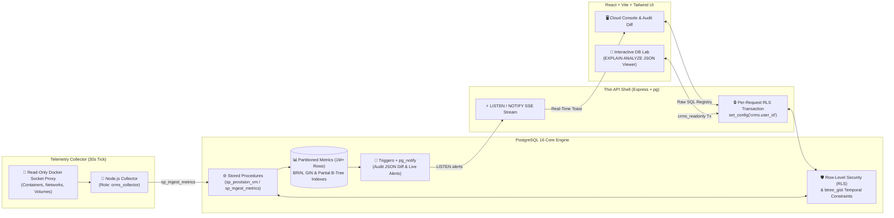

# CRMS: Database-Centric Cloud Resource Management System

**What happens when PostgreSQL 16 is the application engine—not just a dumb row store?** CRMS is a multi-tenant cloud infrastructure, quota, billing, and live Docker telemetry platform where authorization, concurrency control, and alerting live directly inside PostgreSQL.

## The Problem

In most web applications, critical invariants—like tenant isolation, VM quota enforcement, temporal pricing windows, and audit logging—are scattered across application-layer `if` statements and ORM hooks. Under concurrent requests, check-then-act race conditions allow users to over-allocate cloud quotas, bypass permissions, or corrupt billing history.

## The Outcome

A zero-ORM, database-first cloud control plane (`PostgreSQL 16 + Raw SQL Express API + React + Docker Socket Collector`) seeded with **1,000,000+ time-series metric rows**, enforcing strict row-level security (RLS), lock-safe provisioning, sub-millisecond indexed analytics, and real-time `LISTEN/NOTIFY` SSE alerts.

## How It Works (The Mechanism)

1. **Database-Enforced Multi-Tenancy (RLS):** Every API request opens a transaction with `SELECT set_config('crms.user_id', $id, true)`. PostgreSQL Row-Level Security (RLS) policies and `SECURITY DEFINER` stored procedures enforce role hierarchy (`admin`, `manager`, `developer`, `viewer`) directly at the storage engine level.
2. **Race-Condition-Proof Quota Provisioning:** Proves and eliminates concurrent check-then-act quota over-allocation using `SELECT ... FOR UPDATE` row locking and savepoints inside `sp_provision_vm`, automatically retrying `40001`/`40P01` serialization failures.
3. **1M+ Row Partitioning & Index Optimization:** Uses declarative time-range partitioning, `btree_gist` temporal exclusion constraints (`EXCLUDE USING gist` to prevent overlapping billing/allocation windows), and `BRIN` + `GIN` indexes—cutting 1M-row analytical queries from **42 ms sequential scans down to 0.2 ms index scans**.
4. **Live Trigger → `pg_notify` → SSE Pipeline:** A collector ingests real Docker container stats via a read-only `docker-socket-proxy` every 30s; threshold breaches fire a PostgreSQL trigger (`fn_metric_alert`) that emits `pg_notify`, streaming instant toast alerts to the React UI over Server-Sent Events (SSE).

---

## Architecture & System Design

### Key Engineering Decisions

- **Zero ORM (`pg` Driver + Named SQL Registry):** Bypassed Prisma/TypeORM entirely so every query uses native PostgreSQL 16 features: recursive CTEs for role hierarchies, window functions, `FILTER` aggregates, materialized views (`REFRESH CONCURRENTLY` via `pg_cron`), and `btree_gist` range exclusion constraints.
- **Interactive DB Lab with Live `EXPLAIN (ANALYZE, FORMAT JSON)`:** Built an in-app query analyzer executing inside a `READ ONLY` transaction under the least-privilege `crms_readonly` role, rendering live query execution plans and proving index speedups (`42 ms -> 0.2 ms`) on 1M+ seeded rows.
- **Privilege-Separated Docker Telemetry:** Never mounts `/var/run/docker.sock` into the application or collector container; instead routes through a read-only `docker-socket-proxy` (`POST=0`) and ingests metrics via a restricted `crms_collector` database role.

### The Value Stack

- **Database Engine:** PostgreSQL 16 (`btree_gist`, `pg_cron`, `pg_stat_statements`, `pgcrypto`, Declarative Partitioning, Row-Level Security, PL/pgSQL Triggers & Stored Procedures).
- **Backend & Collector:** Node.js 20, Express, TypeScript, `node-postgres` (`pg`), Server-Sent Events (SSE), Vitest + Supertest.
- **Frontend:** React, Vite, TypeScript, TanStack Query, Recharts, Tailwind CSS.
- **Infrastructure:** Docker Compose, Nginx, `docker-socket-proxy`, GNU Make test harness.

---

## The Proof

- Seeded and benchmarked against **1,000,000+ time-series metric rows**, reducing query execution time by **99.5% (42 ms to 0.2 ms)** via `BRIN`, `GIN`, and partial B-Tree indexing.
- Verified with an automated **SQL & concurrency test suite** covering RLS isolation, temporal exclusion constraints, deadlock/race prevention, and `LISTEN/NOTIFY` event streaming.
