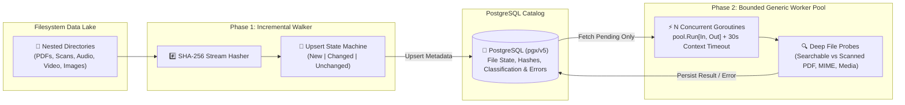

# GoLakeScanner: Concurrent Data-Lake File Classifier & Indexer

**A fault-tolerant Go CLI and worker-pool pipeline that walks, hashes, classifies, and indexes unstructured data lakes into PostgreSQL.**

## The Problem

Unstructured data lakes accumulate thousands of PDFs, scanned invoices, audio recordings, videos, and corrupted files across deeply nested directories. Re-scanning an entire directory tree from scratch on every run wastes CPU and I/O, while a single malformed PDF or hung external probe (`ffprobe`/`pdftotext`) can stall a naive single-threaded scanner indefinitely.

## The Outcome

A fast, incremental Go ingestion pipeline (`Go + pgx/v5 + Bounded Worker Pool + PostgreSQL`) that detects `new`, `changed`, and `unchanged` files via SHA-256 content addressing, isolates per-file classification behind strict context timeouts, and catalogs rich media/document metadata idempotently.

## How It Works (The Mechanism)

1. **Incremental Content-Addressed Walking:** Streams the filesystem tree, computing SHA-256 hashes and file sizes to upsert records into PostgreSQL as `new`, `changed`, or `unchanged`—ensuring unchanged files are never re-classified on subsequent runs.
2. **Bounded Generic Worker Pool (`pool.Run[In, Out]`):** Dispatches pending unclassified files across `N` concurrent goroutine workers using Go generics (`[In, Out any]`), channels, and `sync.WaitGroup` with per-item `context.WithTimeout` deadlines (default `30s`).
3. **Deep Magic-Byte & Subprocess Probing:** Inspects file headers and invokes bounded external probes to classify files beyond simple extensions—distinguishing **searchable text PDFs** from **scanned image-only PDFs**, detecting **corrupted/broken archives**, and extracting audio/video/image stream metadata.
4. **Graceful `SIGINT`/`SIGTERM` Resumability:** Traps OS interrupt signals via `signal.NotifyContext`, cancelling in-flight workers cleanly while persisting partial progress in PostgreSQL so interrupted scans resume seamlessly on the next run.

---

## Architecture & System Design

### Key Engineering Decisions

- **Two-Phase Walk-Then-Classify Pipeline:** Separating fast filesystem hashing (Phase 1) from CPU/subprocess-bound classification (Phase 2) ensures the directory walk completes rapidly and records an exact snapshot in PostgreSQL before spinning up heavy classification workers.
- **Per-File Context Deadlines & Fault Isolation:** If a corrupted file causes a classification probe to error or time out after 30 seconds, the worker catches the context error, records the failure reason in the PostgreSQL catalog (`SetError`), and continues processing the queue without crashing the pipeline.
- **Zero-ORM `pgx/v5` Connection Pooling:** Uses native `jackc/pgx/v5` for low-overhead binary protocol communication with PostgreSQL.

### The Value Stack

- **Language & Concurrency:** Go (Golang) 1.24, Generics, Goroutines, Channels, `context` cancellation, `os/signal`.
- **Database:** PostgreSQL, `jackc/pgx/v5`.
- **Output & Observability:** Structured JSONL (`stdout`) streaming + summary telemetry (`stderr`).

---

## The Proof

- Built a **generic concurrent worker pool (`pool.Run[In, Out]`)** in Go with per-task timeouts and graceful `SIGINT`/`SIGTERM` cancellation.
- Engineered **idempotent, content-addressed incremental scanning** that skips unchanged files and automatically retries failed or interrupted classifications on the next run.
