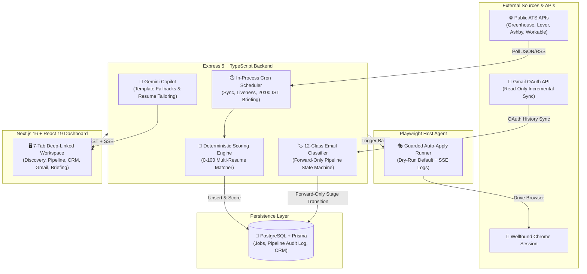

# Job Agent: Autonomous Job-Search & Resume-Scoring Engine

**Stop losing track of internship applications across 15 browser tabs.** Job Agent is a self-hosted job-discovery, deterministic resume-scoring, Gmail ATS classifier, and guarded Playwright auto-apply system built for software engineering roles.

## The Problem

Applying for software engineering internships means checking dozens of company career boards (Greenhouse, Lever, Ashby, Workable), parsing noisy job-alert emails, tailoring multiple resume variants (Backend vs. Full-Stack), tracking recruiter replies in Gmail, and filling repetitive Wellfound forms. Manual tracking leads to missed OA deadlines and stale follow-ups.

## The Outcome

A unified, local-first command center (`Express 5 + PostgreSQL + Next.js 16`) that ingests verified ATS job feeds, scores every role deterministically (`0–100`) against your multiple resumes, classifies incoming Gmail recruiter/ATS threads into 12 states, and generates a daily 20:00 IST briefing.

## How It Works (The Mechanism)

1. **Multi-ATS Ingestion & Liveness Probing:** Polls official public APIs across Greenhouse, Lever, Ashby, SmartRecruiters, Workable, Remotive, Remote OK, and Arbeitnow, plus local Gmail job-alert parsers. Automatically closes stale listings on `404/410` or consecutive missing syncs.
2. **Deterministic Multi-Resume Scoring (`0–100`):** Evaluates every listing against all uploaded resume variants (e.g., *Full-Stack* vs. *AI/Backend*) using word-boundary skill matching, alias resolution (`Java != JavaScript`, `intern != international`), seniority penalties, graduation-year alignment, and recency decay.
3. **12-Class Gmail OAuth State Machine:** Incrementally syncs read-only Gmail threads and classifies emails into 12 categories (OA/Assessment, Interview, Offer, Rejection, Recruiter Outreach, etc.) with ATS-sender awareness—advancing pipeline stages strictly forward-only.
4. **Guarded Playwright Runner:** Automates Wellfound applications through your authenticated Chrome session with a strict `DRY_RUN` default, daily IST rate caps, live SSE log streaming, and failure trace/screenshot capture.

---

## Architecture & System Design

### Key Engineering Decisions

- **Deterministic Word-Boundary Scoring Over Opaque LLM Ranking:** LLM-based job scoring is slow, expensive, and hallucinates matches. Job Agent uses a fast, deterministic 0–100 scoring engine with regex word boundaries, synonym maps, and explicit point breakdowns (`Resume Match: 45`, `Alumni Presence: 20`, `Contacts: 10`, `Freshness: 10`, `Stage: 10`, `Email Activity: 5`).
- **Forward-Only Idempotent Pipeline Transitions:** Automated email syncs and CSV imports can never accidentally move an application backward or overwrite a terminal state (`Offered`, `Rejected`, `Archived`). Every state mutation is recorded in an immutable audit log.
- **Safety-First Browser Automation:** The Playwright Wellfound runner defaults to `DRY_RUN` mode and requires an explicit `confirmLive: true` payload plus typing `APPLY` in the UI before submitting real applications, capturing full HTML/screenshot diagnostics on any DOM selector failure.

### The Value Stack

- **Backend:** Node.js, Express 5, TypeScript, Prisma ORM, PostgreSQL, Google Gmail OAuth2 API, Google Gemini API.
- **Frontend:** Next.js 16, React 19, Tailwind CSS 4, Server-Sent Events (SSE).
- **Automation & Tooling:** Playwright, Docker Compose, Vitest.

---

## The Proof

- Built a **7-tab full-stack operations dashboard** integrating **8+ public ATS APIs** and real-time **Gmail OAuth synchronization**.
- Engineered a **12-class ATS email classifier** and **multi-resume scoring engine** with zero-hallucination deterministic explanations.
