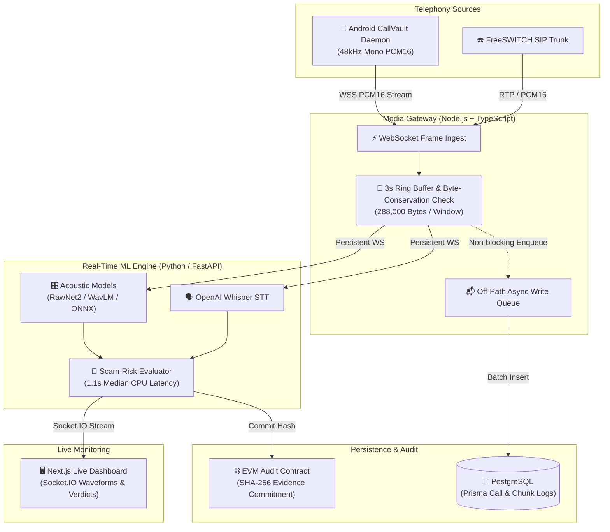

# VoiceShield AI: Real-Time Audio Scam & Deepfake Detection Pipeline

**Smart India Hackathon (SIH) College Finalist — VIT Vellore.** VoiceShield AI intercepts live telephony streams and runs real-time acoustic deepfake detection, speech-to-text transcription, and scam-risk evaluation without interrupting the call.

## The Problem

Voice cloning and social-engineering phone scams happen in real time during live calls. Traditional post-call forensic tools analyze recordings only after the victim has already transferred money or shared sensitive credentials. Worse, streaming raw telephony audio directly into heavy Python ML models causes frame drops, backpressure stalls, and database write bottlenecks.

## The Outcome

A sub-second, fault-tolerant real-time audio analysis pipeline that streams 48 kHz mono PCM16 audio over WebSockets, isolates slow database writes off the hot audio path, runs multi-model acoustic + Whisper inference in 1.1s median per 3-second window, and anchors tamper-evident forensic commitments on-chain.

## How It Works (The Mechanism)

1. **Deterministic 3-Second Audio Chunking:** A custom Node.js/TypeScript Media Gateway ingests arbitrary WebSocket PCM16 frames from an on-device Android daemon (`CallVault`) or SIP/FreeSWITCH trunk, reassembling them into exact 3-second buffers (`288,000 bytes`) verified by a strict byte-conservation invariant.
2. **Hot-Path Isolation:** Audio buffers are routed immediately over a persistent WebSocket to the Python/FastAPI inference worker while PostgreSQL persistence is decoupled onto asynchronous background queues—ensuring database latency never blocks live audio frames.
3. **Multi-Signal Scam Risk Agent:** Combines acoustic synthetic-speech models (`Indic RawNet2`, `Dhwani ONNX`, `WavLM`, `ECAPA-TDNN`) with `OpenAI Whisper` transcriptions inside a quality-gated, rule-based scam-risk evaluator (`1.1s` median CPU latency per 3s window).
4. **Tamper-Evident Audit Trail:** While playable WAV evidence remains off-chain, its SHA-256 fingerprint and canonical AI verdict commitment are anchored to an append-only EVM smart contract.

---

## Architecture & System Design

### Key Engineering Decisions

- **Byte-Conservation Invariant on Frame Reassembly:** Network WebSocket frames arrive in arbitrary byte lengths. The gateway maintains an ordered ring buffer that slices exact 288,000-byte windows (3 seconds of 48 kHz 16-bit mono PCM) and asserts `bytes_in == bytes_emitted + bytes_buffered` across every session, backed by 50+ unit and protocol tests.
- **Off-Path PostgreSQL Queueing:** Writing raw chunk metadata and per-window ML scores synchronously during audio ingestion introduces tail-latency spikes. Queuing Prisma/PostgreSQL writes asynchronously keeps the WebSocket audio loop non-blocking.
- **CPU-Optimized Inference (~0.37x Real-Time Factor):** By combining ONNX Runtime quantization with quality-gated speech windows (VAD/RMS energy filtering), the pipeline achieves a **1.1-second median processing time per 3-second audio window on CPU**, enabling real-time alerting without requiring dedicated cloud GPUs.
- **Zero-PC Android Call Interception (`CallVault`):** Built a companion Android daemon that pairs via on-device Wireless Debugging to capture live call audio streams directly on the handset without requiring a tethered PC.

### The Value Stack

- **Media Gateway:** Node.js, TypeScript, WebSockets (`ws`), Socket.IO, Prisma ORM, Vitest (50+ tests).
- **ML Inference Backend:** Python, FastAPI, PyTorch, OpenAI Whisper, ONNX Runtime, SpeechBrain (`ECAPA-TDNN`), `RawNet2`, `WavLM`.
- **Frontend & Telephony:** Next.js, React, Tailwind CSS, FreeSWITCH (SIP), Kotlin (Android `CallVault` daemon).
- **Data & Integrity:** PostgreSQL, Solidity / EVM Append-Only Audit Contract.

---

## The Proof

- Selected as a **Smart India Hackathon (SIH) College Finalist** at VIT Vellore.
- Benchmarked at **1.1 s median inference latency** per 3-second audio chunk on CPU (**2.7x faster than real-time**).
- Validated by **50+ automated unit and integration tests** covering frame reassembly, protocol invariants, and session lifecycle.
